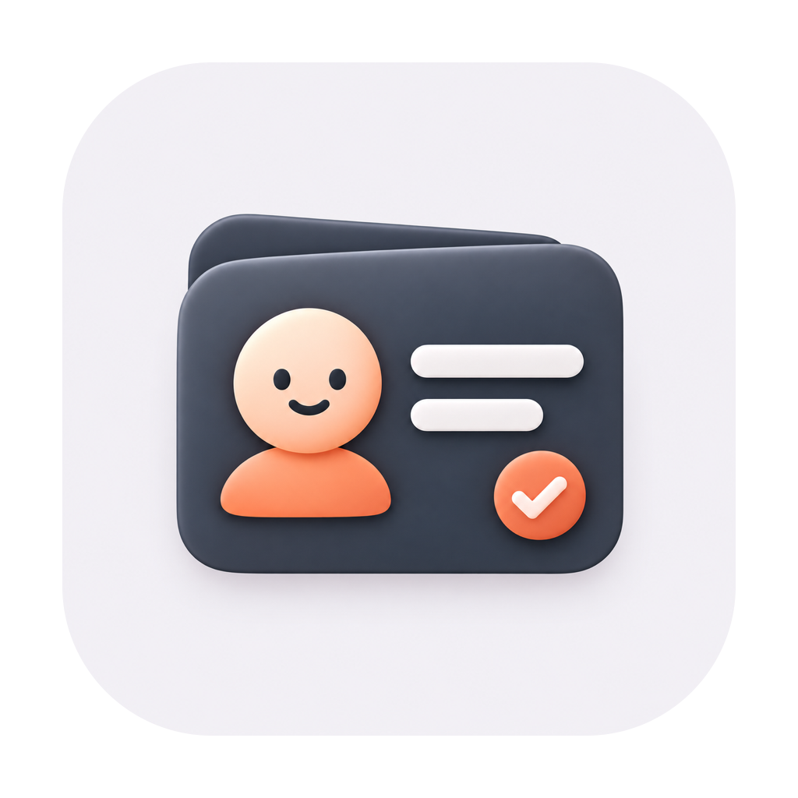

  <picture>
    <source media="(prefers-color-scheme: dark)" srcset="App/Resources/AppIcon-dark.png">
    
  </picture>

<h1 align="center">有头有脸</h1>

给已有企业名片补上短信号码，让 iPhone 的信息列表有名字、有头像。

  <a href="https://github.com/LookUplus/you-tou-you-lian/releases/download/v0.3.4/YouTouYouLian-0.3.4-macOS-AppleSilicon-GUI.zip"><strong>下载 Mac App · 0.3.4 预览版</strong></a>
  · <a href="https://github.com/LookUplus/you-tou-you-lian/releases">所有发布版本</a>
  · <a href="图形版使用说明.md">详细使用说明</a>

这是我借助 AI 做的一个 Mac 小工具，配合 [metowolf/vCards](https://github.com/metowolf/vCards) 使用。它读取短信开头的 `【品牌签名】`，匹配黄页资料和通讯录里已有的企业名片，核对后批量补充 106 短信号码。全程通过图形界面操作，无需终端。

## 下载与安装

**[直接下载 App ZIP](https://github.com/LookUplus/you-tou-you-lian/releases/download/v0.3.4/YouTouYouLian-0.3.4-macOS-AppleSilicon-GUI.zip)**，解压后把「有头有脸.app」放进「应用程序」文件夹，再打开。也可以到[下载页面](https://github.com/LookUplus/you-tou-you-lian/releases/tag/v0.3.4)的 **Assets** 中选择 App 下载包；`Source code` 是源码。

| 项目 | 当前情况 |
| --- | --- |
| 下载包 | Apple 芯片 Mac 版本；Intel Mac 暂无成品 |
| 系统 | 最低系统版本为 macOS 13；目前运行验证环境为 macOS 27.0.1，其他系统尚未实测 |
| 发布状态 | 0.3.4 预览版，使用本地临时签名，尚未完成 Developer ID 签名和 Apple 公证 |

首次打开可能遇到无法验证开发者或未经公证的提示。请先确认文件来自本仓库；如决定继续使用，可按照 [Apple 官方的打开说明](https://support.apple.com/zh-cn/102445)处理。完整的验证范围见[验证说明](验证说明.md)。

## 开始整理

### 1. 备份并准备黄页

先备份通讯录。从 [vCards 下载页面](https://github.com/metowolf/vCards/releases/latest)下载 `archive.zip` 并解压，或下载 `default.vcf`，在联系人 App 中把需要的企业名片导入可编辑的账户。只读的黄页订阅不能直接补号码。

保留这些 `.vcf` 资料，工具还需要用它们匹配企业。确认要整理的短信已经出现在这台 Mac 的信息 App 中；需要同步到 iPhone 时，请使用已开启通讯录同步的 iCloud 账户。

### 2. 切换到「自己的数据」并完成准备

| 准备项 | 怎么操作 |
| --- | --- |
| 短信访问 | 点「打开完全磁盘访问权限」，在系统设置里添加当前这份 App 并打开开关，然后退出、重新打开 App。以检查结果显示「可以读取」为准。 |
| 联系人授权与账户 | 点「授权并读取账户」，允许完整访问，再选择导入企业名片的账户。「打开联系人权限设置」只打开设置页面，不会发起首次授权。 |
| 黄页资料 | 点「选择文件或文件夹…」，选择解压后的 `.vcf` 文件夹或 `default.vcf`。不能直接选 ZIP；这一步不会自动导入联系人。 |

### 3. 扫描、核对、添加

点击「扫描短信」，查看「可添加」里的企业和号码，对照短信核对，取消不需要的勾选。保存方式保持「自动方式（推荐）」，点「添加」，再确认「添加到通讯录」。系统询问是否允许控制联系人 App 时，请允许。

扫描不修改通讯录；只有确认添加后才保存。原有名称、头像、备注和其他号码保留，已有号码不会重复添加。

### 4. 查看结果或撤销

到「操作记录」查看结果，再去联系人 App 核对。存进 iCloud 账户的名片由系统同步到其他设备。需要撤销时，点击「撤销这次添加…」：只移除那次新增、之后没有被编辑的号码。

下次打开会记住资料和账户，但添加前仍需重新扫描、核对。

## 常见问题

**完全磁盘访问已打开，为什么仍然无法读取？**

更换新版后，系统设置可能仍显示旧授权。重新进入权限页面刷新；如仍失败，移除旧的「有头有脸」条目，再添加当前这份 App，并退出、重新打开。准备页可以在 Finder 中定位当前 App，避免选中另一份同名文件。若提示找不到短信数据库，先打开信息 App 并等待短信同步。

**为什么有些号码没有匹配上？**

只处理 106 开头的短信号码，签名、黄页公司名和已有公司名片需要一致。工具不会推断简称或子品牌归属；共用号码、缺少签名、重复名片等情况会跳过。具体原因在结果中查看，没匹配上的可手动维护。

**添加报错，能直接再点一次吗？**

先看「操作记录」，再去联系人 App 核对，部分号码可能已经保存。核对后重新扫描，不要反复提交旧结果。拿不准的保存结果不会自动重试或自动撤销，详见[异常处理说明](图形版使用说明.md#撤销记录和异常提示)。

## 数据与隐私

App 在本机处理，不联网、不上传短信或通讯录，不调用 AI 服务。AI 参与了开发，运行时的匹配由本地规则完成。

操作记录含号码、品牌和撤销所需的电话字段，不保存短信全文或验证码。反馈问题时请遮住个人信息，不要上传短信数据库、通讯录备份或真实操作记录。

短信签名不是身份认证，匹配也仅依据本机保留的历史。显示了企业名称和头像，不代表短信、链接或来电可信。

## 反馈、开发与许可

遇到问题可在 [Issues](https://github.com/LookUplus/you-tou-you-lian/issues) 中说明 App 版本、macOS 版本、芯片类型和复现步骤。自行构建或参与改进，请看[开发与验证](docs/开发与验证.md)、[命令行用法](docs/命令行用法.md)及[贡献说明](CONTRIBUTING.md)。

感谢 [metowolf/vCards](https://github.com/metowolf/vCards) 作者和维护者持续整理企业名片。本项目与 vCards 无隶属关系，不内置其名片资料；黄页资料遵守原项目许可。

本项目源码及自有图标采用 [MIT 许可](LICENSE)。
